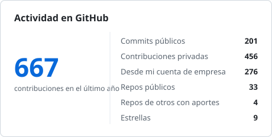
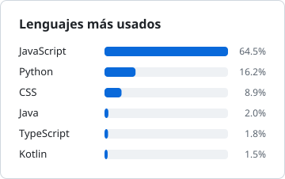
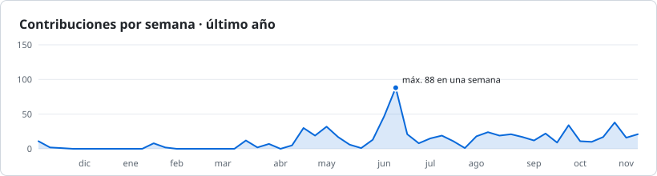

<h1 align="center">Hola, soy Fabio Ochoa 👋</h1>

  <b>Analista de Software · Desarrollador full-stack</b> · Lima, Perú 🇵🇪 
  Construyo APIs, dashboards en tiempo real, sitios web y aplicaciones con IA, de la base de datos a la interfaz.

  
  
  
  
  

---

### 🧑‍💻 Sobre mí

- 💼 Actualmente soy **Analista de Software** en **IDS Latam**, consultora especializada en software.
- 🎓 Egresado de **Diseño y Desarrollo de Software** en **TECSUP**, con intercambio académico en la **Universidad Tecnológica Metropolitana de Mérida (México)**.
- 🏆 Mi tesis, **ProfeTEC.IA** (un tutor virtual con IA generativa), fue aprobada con **nota sobresaliente** y quedó en el **puesto 2 de la facultad**.
- 🤝 He trabajado en proyectos para empresas como Caja Arequipa, Promart, Molitalia, Compartamos Banco y CC Caminos del Inca.
- 🧭 Me muevo cómodo entre el desarrollo y la gestión: trabajo con metodologías ágiles y he liderado proyectos de TI.
- 🌎 Inglés: nivel **B1 (MCER)**.

---

### 💼 Experiencia

**Analista de Software — IDS Latam** · *Julio 2026 – Actualidad*
Consultoría especializada en software.

**Comutel Perú** · *Enero 2025 – Julio 2026*
Servicios y consultoría de TI a nivel corporativo. Crecí de practicante a gestor de proyectos:

- **Gestor de Proyectos de TI** · *Enero 2026 – Julio 2026*
- **Analista de TI** · *Junio 2025 – Enero 2026*
- **Practicante de Plataformas Tecnológicas** · *Enero 2025 – Junio 2025*

Lo que construí ahí:

- **Comutel Leads 2.0**: gestión de leads con dashboard de gerencia en tiempo real. Recibe leads por webhooks desde SendPulse, mide SLAs en horas hábiles y empuja los cambios al panel con Socket.io. ([repo de la empresa](https://github.com/Comutel-Peru/Dashboard-Leads))
- **Vantio**: CRM B2B multi-empresa con roles, planificador comercial, KPIs de rentabilidad y asistencia sincronizada con BioTime.
- **Plugin para GLPI**: genera y adjunta automáticamente PDFs de RR. HH. y TI a los tickets según su estado de validación.
- Implementación y consultoría ITAM/ITSM para clientes corporativos.

---

### 🌐 Sitios web

Sitios en producción que diseñé, desarrollé y publiqué de principio a fin:

| Sitio | Descripción | Stack |
|---|---|---|
| [**Centro Comercial Caminos del Inca**](https://caminos.com.pe)   🔗 [caminos.com.pe](https://caminos.com.pe) | Web oficial del centro comercial en Santiago de Surco: directorio de más de 170 tiendas generado automáticamente, eventos, servicios y SEO (sitemap, metadatos Open Graph). | HTML · Tailwind CSS · JavaScript · Cloudflare |
| [**SER EXTRAORDINARIO®**](https://ser-extraordinario.com)   🔗 [ser-extraordinario.com](https://ser-extraordinario.com) | Sitio de marca de un método de desarrollo personal: páginas del método y la creadora, blog, formulario de contacto y SEO con datos estructurados. | Astro · TypeScript · Tailwind CSS · Cloudflare |

---

### 🚀 Proyectos destacados

| Proyecto | Descripción | Stack |
|---|---|---|
| [**ProfeTEC.IA**](https://github.com/FabioOC01/ProfeTEC) | Tutor virtual con IA para estudiantes de TECSUP. Arquitectura RAG multimodal sobre Gemini (Vertex AI), desplegado en Cloud Run. *Tesis con nota sobresaliente.* | FastAPI · React · Firestore · GCP |
| [**Dashboard de Leads**](https://github.com/FabioOC01/Dashboard-Leads) | Gestión de leads y dashboard de ventas en tiempo real con webhooks, SLAs en horas hábiles y actualizaciones al instante. | Node.js · Express · PostgreSQL · Socket.io · React |
| [**Vantio CRM**](https://github.com/FabioOC01/Vantio-CM-old) | CRM B2B multi-empresa: planificador comercial, clientes, KPIs de rentabilidad, asistencia y eventos en tiempo real. | Node.js · PostgreSQL · React · JWT |
| [**Generador de PDFs para GLPI**](https://github.com/FabioOC01/Generador-de-PDFs-GLPI) | Plugin para GLPI 11 que genera y adjunta PDFs (vacaciones, conformidad de equipos) al cambiar el estado de un ticket. | PHP · Twig |
| [**Farmacia**](https://github.com/FabioOC01/farmacia-backfront-Ochoa) | Aplicación full-stack de gestión para una farmacia. | Next.js · TypeScript |

---

### 🛠️ Tecnologías

**Lenguajes**

  
  
  
  
  
  

**Frontend**

  
  
  
  
  
  
  

**Backend**

  
  
  
  
  
  
  

**Bases de datos**

  
  
  
  

**Cloud y herramientas**

  
  
  
  
  
  
  

---

### 📜 Certificaciones

- 🤝 **GLPI Partner** (2026 – 2027)
- ☁️ **Technical Certification**, Wasabi Technologies (2026)
- 💻 **Foundational C#** con Microsoft (2026)
- 🛠️ **Certified Consultant ITAM/ITSM**, ProactivaNET (2025)
- 🌎 **English Proficiency Certificate**, CEFR B1

---

### 📊 Aportes y estadísticas

- 🔨 Contribuyo en repositorios de equipo como [`Comutel-Peru/Dashboard-Leads`](https://github.com/Comutel-Peru/Dashboard-Leads) y [`ConectaTEC`](https://github.com/jeffersonrojas150/ConectaTEC).
- 🔒 Gran parte de mi trabajo diario vive en repositorios privados de empresa. Las cifras suman mi cuenta personal y mi cuenta de empresa ([@OrlandoOchoa](https://github.com/OrlandoOchoa)), y se actualizan cada día.

  <picture>
    <source media="(prefers-color-scheme: dark)" srcset="stats/stats-dark.svg">
    
  </picture>
  <picture>
    <source media="(prefers-color-scheme: dark)" srcset="stats/languages-dark.svg">
    
  </picture>

  <picture>
    <source media="(prefers-color-scheme: dark)" srcset="stats/activity-dark.svg">
    
  </picture>

  

---

### 📫 Contacto

  
  
  <!-- Si quieres mostrar tu correo, descomenta esta línea y pon tu dirección:
  
  -->

<i>¡Gracias por pasar por aquí! ⭐</i>

